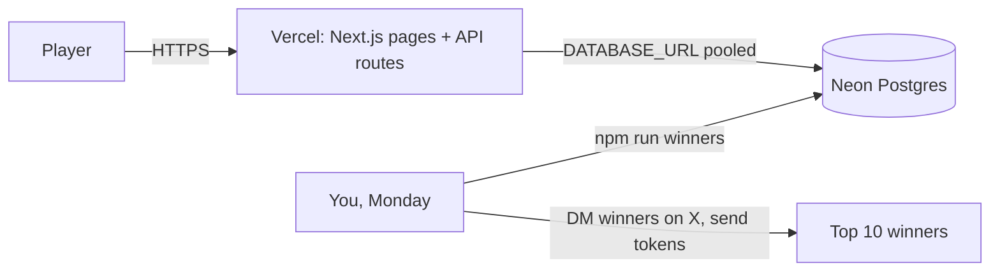
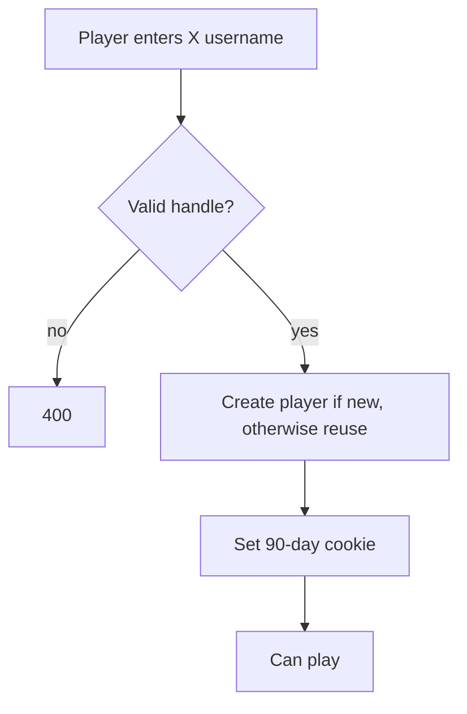
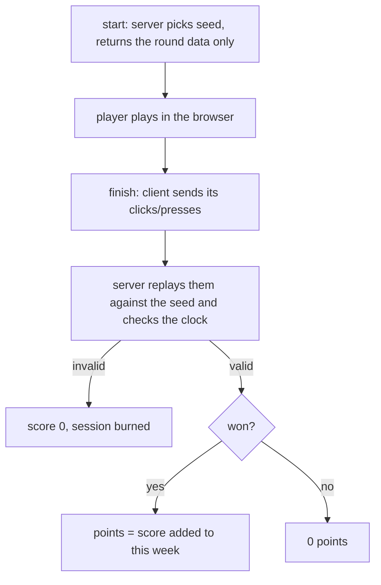

# ⚡ HashRush

Skill games → points → weekly leaderboard → **top 10 paid in $HASHRUSH (pump.fun / Solana) every Monday (manually)**.

Stack: **Next.js 15 (Vercel)** · **Neon Postgres** (`@neondatabase/serverless`) · X-handle login (no email, no wallet). Prizes are sent **manually**.

## Architecture

## Login
Login = enter your **X username** (`@name`, `x.com/name` or `name`). No email, no wallet, no password. A new handle creates the account; an existing handle logs straight in (90-day cookie). The X account is not connected; the handle is only stored so you can DM winners and ask for their Solana address.

Trade-off: the handle is not verified, so anyone can log in as any handle. Points can only be added, so the worst case is someone grinding points on another person's handle. Confirm in the DM that the winner really owns the account before paying.

## Games
Both games share one flow: `POST /api/game/start {game}` -> play -> `POST /api/game/finish`. Each game has its own verifier in `src/lib/games.ts`; the server stores a secret seed per session and scores it exactly once. A "won" game adds its score to the weekly leaderboard.

| Game | Rules | Win | Server checks |
|---|---|---|---|
| Hash Rush (`/play/hashrush`) | 30s, click the hash starting with the target: +10 / -5 | score >= 100 | replays clicks vs secret answers, ~30s elapsed, >= 250ms between clicks |
| Chain Memory (`/play/chain`) | watch a block sequence, repeat it, +1 block per level, one mistake ends it; +15 per level, max 20 | 7+ levels (105 pts) | replays presses vs secret sequence; wall-clock must cover the playback time of every level reached |

Adding a game = add a verifier + catalogue entry in `src/lib/games.ts` and a page under `src/app/play/`. Daily cap: 50 sessions per game per player.

## Monday routine (manual)

Split (rank 1→10): 30/20/15/10/8/6/4/3/2/2 % of `WEEKLY_PRIZE_POOL` (edit `SPLIT` in `scripts/winners.ts`). Ties go to whoever reached their total first. Weeks run Mon 00:00 → Sun 23:59 UTC, so run the script any time after Monday 00:00 UTC.

## Setup
1. **Neon**: create project, copy the *pooled* connection string → `DATABASE_URL`. Run `psql "$DATABASE_URL" -f db/schema.sql` on a fresh DB.
2. **Vercel**: import repo, set `DATABASE_URL` and `SESSION_SECRET` (random 32+ chars).
3. **Local**: copy `.env.example` to `.env.local`; `npm run dev`. Tests: `npm test`. Weekly winners: `npm run winners`.
4. Launch the token on pump.fun and keep the prize tokens in your own wallet. No keys are stored in the app.

## Known limits / before going live
- Bots: click-timing checks only stop naive scripts. For real money consider Cloudflare Turnstile on `/game/start`, per-IP limits, and manual review of the top 10 before payout (set the DB rows, then run).
- Prize games may be regulated as gambling/promotions in some jurisdictions; keep it free-to-play and check local rules/ToS.
