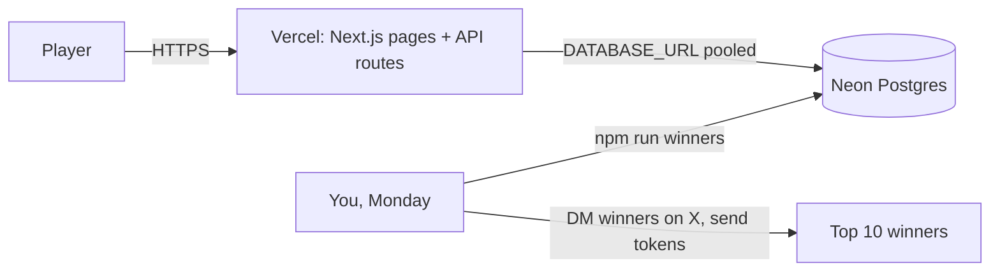
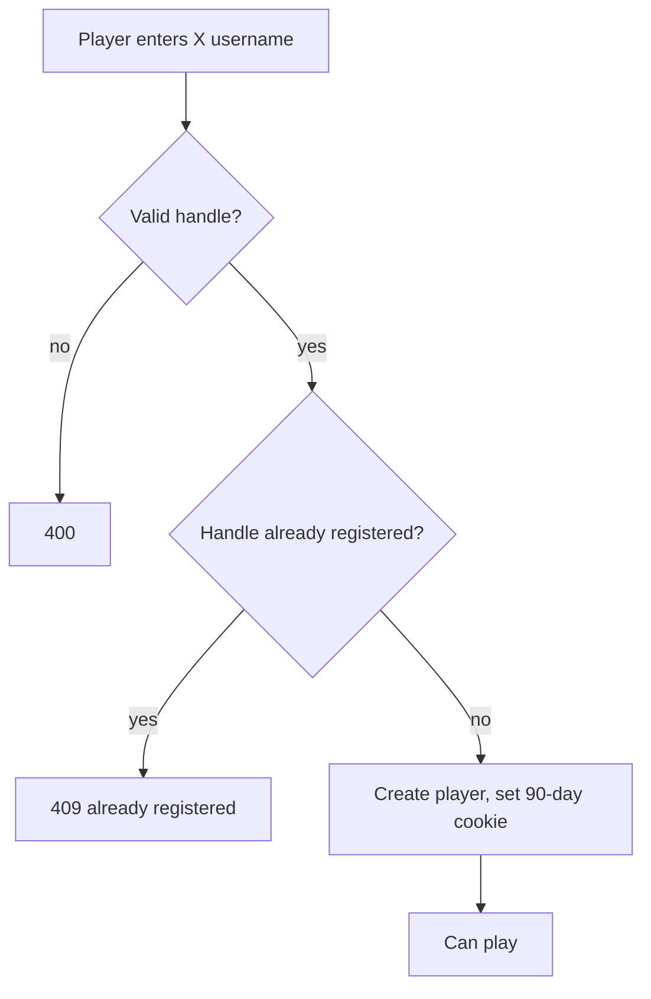
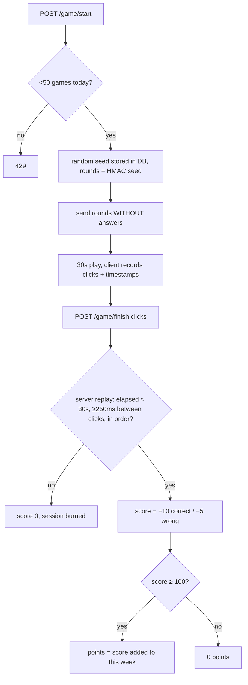

# ⚡ HashRush

Skill games → points → weekly leaderboard → **top 10 paid in $HASHRUSH (pump.fun / Solana) every Monday (manually)**.

Stack: **Next.js 15 (Vercel)** · **Neon Postgres** (`@neondatabase/serverless`) · X-handle signup (no email, no wallet). Prizes are sent **manually**.

## Architecture

## Sign-up
Players enter only their **X username** (`@name`, `x.com/name` or `name`; 1-15 letters/digits/underscore, unique case-insensitive). No email, no wallet, no password. The server sets a 90-day cookie. The X account is not connected, the handle is only stored so you can DM winners and ask for their Solana address.

Trade-offs: handles are not verified (someone can register another person's handle first, so confirm identity in the DM before paying), and a player who clears cookies or switches device cannot log back into the same account.

## One game (server-authoritative anti-cheat)

`finished_at is null` in the UPDATE guarantees a session is scored once.

## Monday routine (manual)

Split (rank 1→10): 30/20/15/10/8/6/4/3/2/2 % of `WEEKLY_PRIZE_POOL` (edit `SPLIT` in `scripts/winners.ts`). Ties go to whoever reached their total first. Weeks run Mon 00:00 → Sun 23:59 UTC, so run the script any time after Monday 00:00 UTC.

## Setup
1. **Neon**: create project, copy the *pooled* connection string → `DATABASE_URL`. Run `psql "$DATABASE_URL" -f db/schema.sql` on a fresh DB.
2. **Vercel**: import repo, set `DATABASE_URL` and `SESSION_SECRET` (random 32+ chars).
3. **Local**: copy `.env.example` to `.env.local`; `npm run dev`. Tests: `npm test`. Weekly winners: `npm run winners`.
4. Launch the token on pump.fun and keep the prize tokens in your own wallet. No keys are stored in the app.

## Known limits / before going live
- Bots: click-timing checks only stop naive scripts. For real money consider Cloudflare Turnstile on `/game/start`, per-IP limits, and manual review of the top 10 before payout (set the DB rows, then run).
- Prize games may be regulated as gambling/promotions in some jurisdictions; keep it free-to-play and check local rules/ToS.
