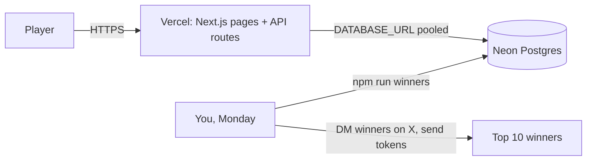
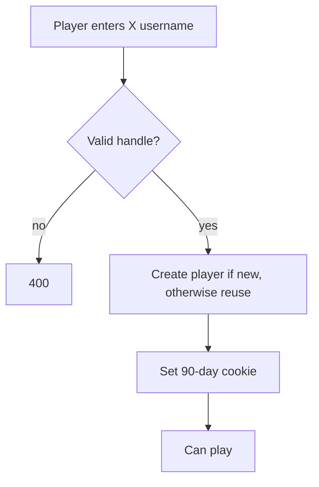
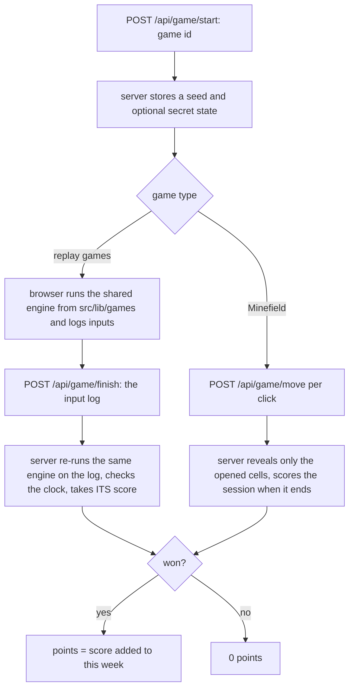

# ⚡ HashRush

Skill games → points → weekly leaderboard → **top 10 paid in $HASHRUSH (pump.fun / Solana) every Monday (manually)**.

Stack: **Next.js 15 (Vercel)** · **Neon Postgres** (`@neondatabase/serverless`) · X-handle login (no email, no wallet). Prizes are sent **manually**.

## Architecture

## Login
Login = enter your **X username** (`@name`, `x.com/name` or `name`). No email, no wallet, no password. A new handle creates the account; an existing handle logs straight in (90-day cookie). The X account is not connected; the handle is only stored so you can DM winners and ask for their Solana address.

Trade-off: the handle is not verified, so anyone can log in as any handle. Points can only be added, so the worst case is someone grinding points on another person's handle. Confirm in the DM that the winner really owns the account before paying.

## Games
| Game | Route | Rules | Win (score becomes points) | How the server checks it |
|---|---|---|---|---|
| Block Stack (tetris-style) | `/play/blocks` | no timer, falls faster every 15s, lines score 20/50/80/120 | score >= 60 | replays the input log in the same engine |
| Brick Chaos | `/play/bricks` | endless levels (5 patterns, boss every 5th), power-ups, 10 volleys of 3 bullets, 3 lives, no timer | score >= 60 | replays the paddle + fire log in the same physics engine |
| Minefield | `/play/mines` | easy / medium / hard, random map shape, time limit, speed bonus | all safe squares opened | mine layout never leaves the server: one request per click |
| Color Sort | `/play/sort` | 5 levels, more colours and fewer spare moves each | 2+ levels cleared | replays the move list; levels are solver-checked |

- Engines live in `src/lib/games/*.ts` and are imported by both the page and the API, so client and server can never disagree. They use a seeded PRNG and only deterministic maths.
- Replay games also enforce real time: a game of N ticks cannot be submitted before N/60 seconds have passed. Block Stack and Brick Chaos have a 20-minute safety cap.
- Each session is scored exactly once; cap of 50 sessions per game per player per day.
- To add a game: an engine + `GameDef` and `CATALOG` entry in `src/lib/games.ts`, and a page under `src/app/play/<id>/`.
- Limit: in replay games the browser knows the seed, so a bot can play well. It still has to play in real time. Minefield hides its secret properly.

## Monday routine (manual)

Split (rank 1→10): 30/20/15/10/8/6/4/3/2/2 % of `WEEKLY_PRIZE_POOL` (edit `SPLIT` in `scripts/winners.ts`). Ties go to whoever reached their total first. Weeks run Mon 00:00 → Sun 23:59 UTC, so run the script any time after Monday 00:00 UTC.

## Setup
1. **Neon**: create project, copy the *pooled* connection string → `DATABASE_URL`. Run `psql "$DATABASE_URL" -f db/schema.sql` on a fresh DB.
2. **Vercel**: import repo, set `DATABASE_URL` and `SESSION_SECRET` (random 32+ chars).
3. **Local**: copy `.env.example` to `.env.local`; `npm run dev`. Tests: `npm test`. Weekly winners: `npm run winners`.
4. Launch the token on pump.fun and keep the prize tokens in your own wallet. No keys are stored in the app.

## Known limits / before going live
- Bots: click-timing checks only stop naive scripts. For real money consider Cloudflare Turnstile on `/game/start`, per-IP limits, and manual review of the top 10 before payout (set the DB rows, then run).
- Prize games may be regulated as gambling/promotions in some jurisdictions; keep it free-to-play and check local rules/ToS.
