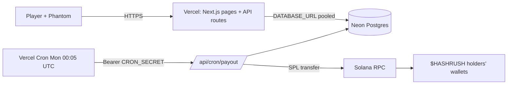
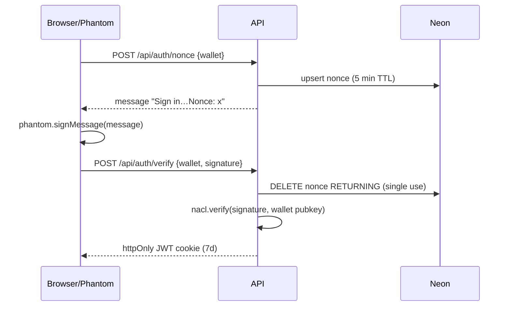
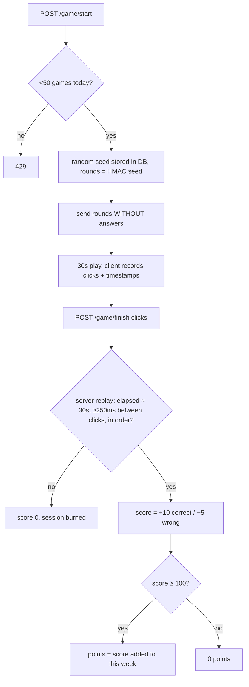
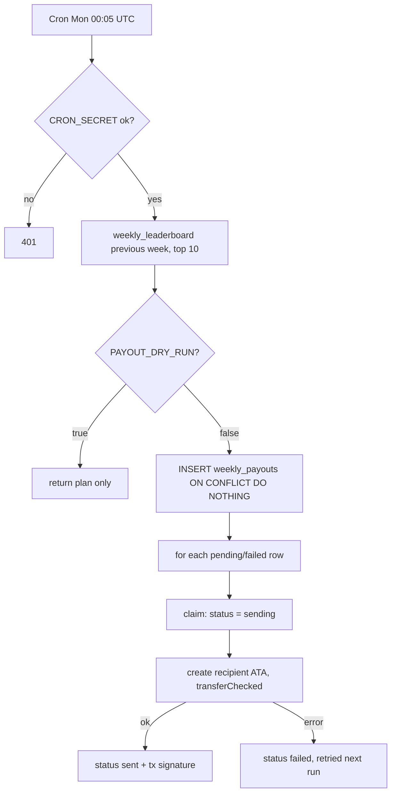

# ⚡ HashRush

Skill games → points → weekly leaderboard → **top 10 paid in $HASHRUSH (pump.fun / Solana) every Monday 00:05 UTC**.

Stack: **Next.js 15 (Vercel)** · **Neon Postgres** (`@neondatabase/serverless`) · Solana wallet login (Phantom) · Vercel Cron.

## Architecture

## Login (no passwords – wallet signature)

## One game (server-authoritative anti-cheat)

`finished_at is null` in the UPDATE guarantees a session is scored once.

## Monday payout

Split (rank 1→10): 30/20/15/10/8/6/4/3/2/2 % of `WEEKLY_PRIZE_POOL`. Ties are broken by who reached their total first.

## Setup
1. **Neon**: create project, copy the *pooled* connection string → `DATABASE_URL`. Then `psql "$DATABASE_URL" -f db/schema.sql`.
2. **pump.fun**: launch the token, put its mint in `HASHRUSH_MINT`. Fund a *dedicated* prize wallet with tokens (+ ~0.05 SOL for fees/ATA rent); its base58 secret → `TREASURY_SECRET_KEY`.
3. **Vercel**: import repo, set all vars from `.env.example` (`SESSION_SECRET`, `CRON_SECRET` = random 32+ chars). `vercel.json` registers the cron.
4. Keep `PAYOUT_DRY_RUN=true` until the dry-run plan in the cron response looks right, then set `false`.
5. Manual run: `npm run payout [YYYY-MM-DD]`. Dev: `npm run dev`; tests: `npm test`.

## Known limits / before going live
- Bots: click-timing checks only stop naive scripts. For real money consider Cloudflare Turnstile on `/game/start`, per-IP limits, and manual review of the top 10 before payout (set the DB rows, then run).
- The treasury key lives in a Vercel env var: use a wallet holding only ~1 week of prizes.
- A row stuck in `sending` (function crashed mid-transfer) is never auto-retried: check the chain, then fix the row by hand.
- Prize games may be regulated as gambling/promotions in some jurisdictions; keep it free-to-play and check local rules/ToS.
